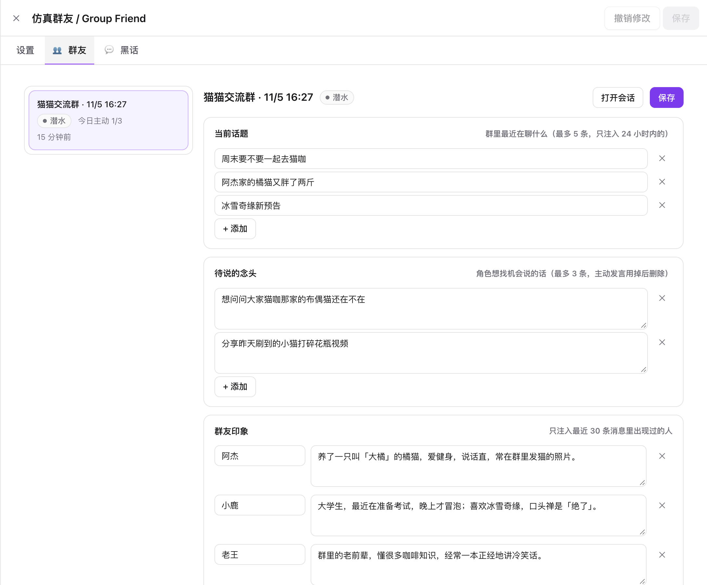
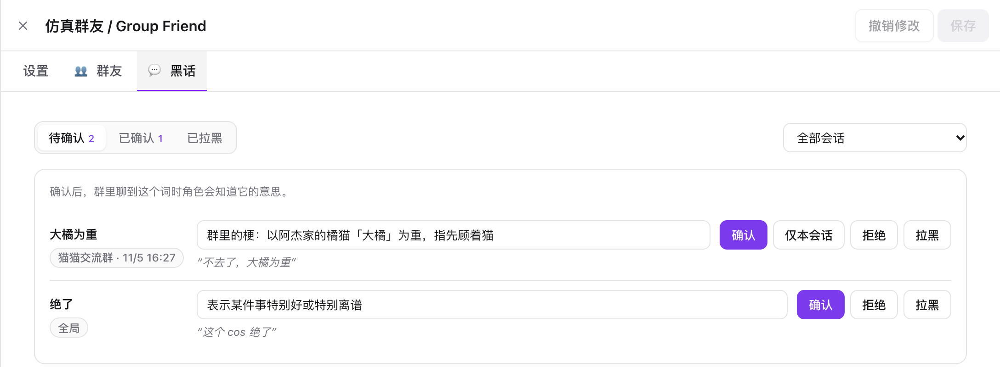
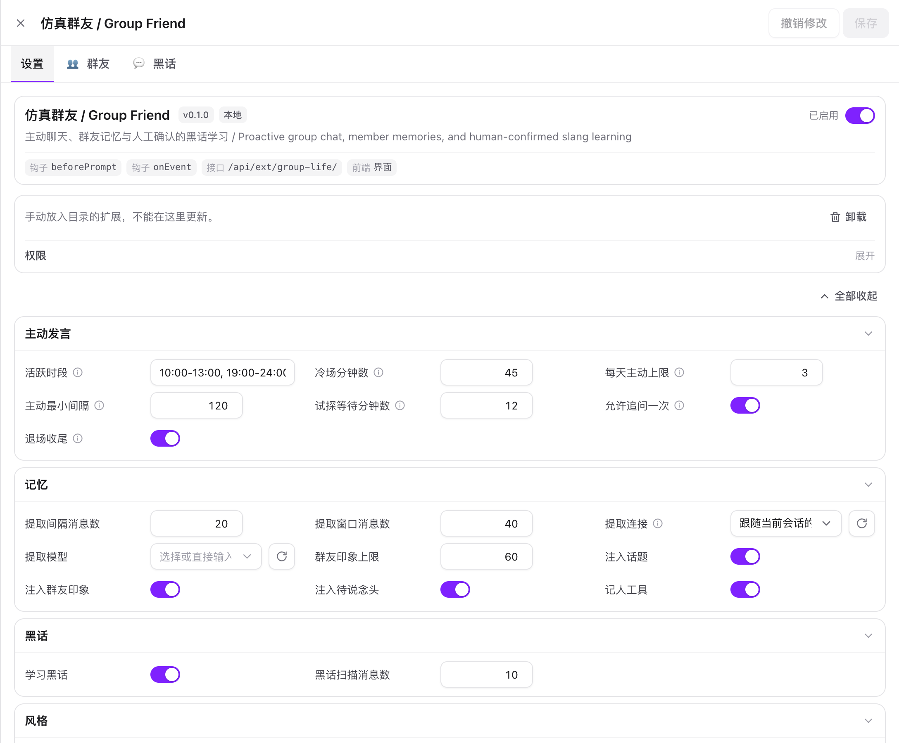

# 仿真群友 / Group Friend

[NoBot](https://github.com/IamJasperJ/NoBot) 扩展：让角色像一个真正的群友。

被叫到时照常回话；冷场时自己起个话题，没人接就追问一句或者说一声「先去忙了」；
平时记得群里在聊什么、记得每个人是什么样的人，还会慢慢学会群里的黑话。

*An extension for NoBot that makes your character behave like a real group-chat member: it starts topics when the chat goes quiet,
remembers what each member is like, and learns the group's slang with your confirmation.*

灵感来自 [qq-bridge](https://github.com/derpyu520/qq-bridge) 的「仿真群友」。收发 QQ / Telegram、选择性接话、表情包、语音、看图这些
NoBot 已经有了（渠道扩展 + 房间「智能接话」），这个扩展只补上它们没有的部分。



## 功能

| 功能 | 说明 |
| --- | --- |
| 状态 | 潜水 → 活跃 → 试探 → 退场。被 @、被回复时永远照常回（由房间 / 渠道决定），状态只影响「主动说话」 |
| 主动发言 | 活跃时段内冷场超过设定分钟数，角色自己起一个贴合群里近期兴趣的话题；每天有上限，两次之间有最小间隔；24 小时没人说话的群不会被叫醒 |
| 试探与退场 | 起了话题没人接：最多追问一次，然后用一句收尾话退场，回到潜水 |
| 时间感 | 默认注入服务器本地的日期、星期、时间与时段，让问候、吃饭、作息和主动话题符合当前时间；可在设置中关闭 |
| 轻量记忆 | 每隔若干条消息用（可选的便宜）模型提取：当前话题、角色想说的念头、每个群友的印象。只注入相关的部分 |
| 记人工具 | 角色可以调用 `remember_member` / `recall_member` 自己记人（需要连接支持工具调用） |
| 黑话学习 | 群里反复出现、含义不明的词进入「待确认」，你确认（可改释义）后，聊到这个词时角色就知道它的意思 |

所有主动发言都是正常的角色回复：带角色卡、世界书、记忆，会话绑在 QQ / Telegram 上时自动发到群里。

## 安装

需要 NoBot 服务器装有 Git。

1. NoBot →「扩展」→「安装」，填入本仓库地址：
   ```
   https://github.com/IamJasperJ/NoBot-extension-GroupFriend.git
   ```
   也可以从 [Releases](https://github.com/IamJasperJ/NoBot-extension-GroupFriend/releases) 下载 `group-life-<版本>.zip`，
   解压到 `<DATA_DIR>/users/<账号>/extensions/group-life/`，再在扩展页点刷新。
2. 确认权限（含「后台任务」）并启用。
3. 打开一个会话（通常是绑到 QQ / Telegram 群的房间）→ 会话设置 →「仿真群友」→ 打开开关。

## 控制方式

**会话设置 →「仿真群友」**

开关、当前状态、今天主动了几次；可以给这个会话单独设活跃时段、冷场分钟数、每天上限；「试探一次」「立刻潜水」。

**扩展页 → 仿真群友**

| 页面 | 做什么 |
| --- | --- |
| 设置 | 全局默认值：活跃时段、冷场分钟数、每天主动上限、最小间隔；记忆提取用的连接和模型；黑话学习开关；群聊风格提示 |
| 群友 | 每个启用会话的当前话题、待说的念头、群友印象，都能直接改 |
| 黑话 | 待确认 / 已确认 / 已拉黑。确认时可以选「全局」或「仅本会话」，也可以先改释义 |

| 黑话 | 设置 |
| --- | --- |
|  |  |

**斜杠命令**（在会话里输入）

| 命令 | 作用 |
| --- | --- |
| `/lurk` | 立刻潜水 |
| `/wake` | 立刻试探一次 |
| `/glstatus` | 查看当前状态 |

## 建议搭配

- 群聊绑定用房间的「智能接话」回合方式：被动接话交给房间判断，主动说话交给本扩展。
- 渠道里打开表情包、轻互动，群友味更足。
- 记忆提取选一个便宜的模型（设置 → 记忆 → 提取连接 / 提取模型）。

## 隐私与边界

- 印象只记录参与聊天的人类群友，存在你自己的 NoBot 数据里，可以随时编辑或删除。
- 黑话的释义由模型按上下文猜，**不联网搜索**，确认前不会生效。
- 本扩展不做任何社交操作（加好友、拉群、踢人），也不会在活跃时段之外主动说话。

## 开发

扩展运行时只依赖 NoBot 宿主。类型检查和测试需要放在 NoBot 仓库的 `external-extension/group-life/` 下：

```bash
bun test external-extension/group-life
bunx tsc --noEmit -p external-extension/group-life
```

接口文档见 [ROUTES.md](ROUTES.md)。

发版：把 `manifest.json` 的 `version` 改好后打同名标签（如 `v0.1.0`）并推送，GitHub Actions 会自动打包并创建 Release。

## 许可

[AGPL-3.0](LICENSE)，与 NoBot 相同。
